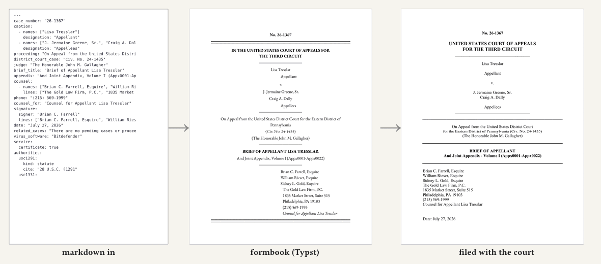

# formbook

**Court-filing templates for markdown-first lawyers: write your brief in markdown, get a PDF that meets the court's rules, checked against a real filed example.**



formbook is an open collection of court-filing templates, one folder per court and document type (opening brief, complaint, motion brief, and so on). Templates are written in [Typst](https://typst.app) and take markdown with a YAML header; the template generates the cover or caption, tables of contents and authorities, spacing, fonts, certificates and signature block that the court's rules call for.

Every template is checked against public record: each folder's `usage/` carries a real filed exemplar PDF (`FILED-EXAMPLE-*.pdf`, with its source URL in `SOURCE.md`), a markdown input (`INPUT-*.md`) and our rendered output PDF (`OUTPUT-*.typst.pdf`). `just overlay <folder>` lays our render over the filed exemplar as a red/blue overlay PDF (generated on demand into the gitignored `.overlay/`, not committed). As of this checkout:

- 1,185 folders have a Typst template (`typst/main.typ`), across 376 courts (federal, state, bankruptcy, and the U.S. Supreme Court).
- 1,307 folders have at least one filed exemplar PDF (2,223 PDFs in all).
- **v0.2.0 status.** All 224 federal courts (including bankruptcy and the Supreme Court) are *up for review*: each has a `rules.md` written from fetched primary sources, and every doc folder under it passes the default eval in `data/checks-default.yaml`. Renders are pinned (typst 0.15.1, Times New Roman 2.82). Of the 152 state courts, 129 are up for review; the other 23 have no public filed example yet (see [Help wanted](#help-wanted-filed-examples-for-23-state-courts)).
- **"Up for review" means machine-checked, not human-reviewed.** No court is marked `done`; that status is set by hand, and no court has been human-verified yet.
- **Typst is the reference engine; DOCX is best effort.** Word has no pleading-paper layout of its own: its line numbering counts only body text, so tables, footnotes and single-spaced blocks fall off the court's 28-line grid, and the workaround (the numbers in a page-anchored text box) draws differently in Word and in LibreOffice. Some DOCX outputs, pleading paper above all, will not look right and may never be able to; that is why the templates are written in Typst. Details: [docs/DOCX.md](docs/DOCX.md#pleading-paper-why-typst-is-the-reference-engine).
- More pictures, and the command that regenerates each: [docs/showcase/README.md](docs/showcase/README.md). Per-court progress is in the [index](#index) at the bottom.

These templates are not legal advice and do not check your arguments or citations. Verify every output against the court's current rules before you file; the court index below marks what is finished and what is still in progress.

## Contribute to open access to the law

Anyone can point their own AI agent at this repo to add courts and document types. Work is split into small units (one court, one document type) listed in `data/worklist.json`; you take one, build it against a real public exemplar, and open a PR. Paste this into Claude Code, Codex, or any agent with a shell and git:

> Clone github.com/davidawad/formbook and read CONTRIBUTING.md and AGENTS.md. Run `sh tools/bootstrap.sh`, then `just contribute pick`. Claim the unit it gives you with `just contribute claim <id>`, do exactly what `just contribute brief <id>` says inside the claimed worktree, make `just contribute verify <id>` pass, then `just contribute submit <id>`. Use only public court records, record every source URL, and look at every rendered page before submitting. If you are blocked on a decision only a human can make, stop and say so in the PR.

The loop that prompt runs:

```sh
just contribute pick            # get a unit; you take the one you are given
just contribute claim <id>      # atomic claim (branch contrib/<id>, or a draft PR from a fork)
just contribute brief <id>      # prints the exact task
just contribute verify <id>     # mechanical floor: layout, renders, exemplar source
just contribute submit <id>     # reruns verify, opens the PR
```

**The agent skills.** The [`skills/formbook/`](skills/formbook) folder holds one `SKILL.md` that teaches an agent to use these templates (find the court, start from a sample, render, look at every page) and to write a new one when a court or document type is missing; [`skills/formbook-review/`](skills/formbook-review) walks a reviewing attorney's agent through reviewing a template (see [Looking for reviewers](#looking-for-reviewers)). Install both for Claude Code with one command from this checkout:

```sh
sh skills/install.sh ~/.claude/skills
```

For other agents (Codex, Cursor, a plain LLM with a shell), point them at `skills/formbook/SKILL.md` or `skills/formbook-review/SKILL.md`. Details: [skills/README.md](skills/README.md). Full contribution rules, quality bar and review process: [CONTRIBUTING.md](CONTRIBUTING.md).

## Help wanted: filed examples for 23 state courts

These courts have a `rules.md` written from primary sources, but we have not found a single publicly available filing from them to build and check a template against. Most are tax courts, workers' compensation boards and small specialty tribunals whose filings are not on free dockets. If you can point to a public filed brief, petition or motion from one of them (a court website, a public agency record, an appellate record), comment on the court's issue below (or open a PR) with the PDF's source URL; that is all it takes to unblock the court.

| Court | Alias | Issue |
|---|---|---|
| [Arkansas Workers' Compensation Commission](courts/eighth-circuit/arkansas/state/workers-compensation-commission) | `arkworkcompcom` | [#4](https://github.com/davidawad/formbook/issues/4) |
| [California Superior Court, Appellate Division](courts/ninth-circuit/california/state/superior-court-appellate-division) | `calappdeptsuper` | [#5](https://github.com/davidawad/formbook/issues/5) |
| [Colorado Industrial Claim Appeals office](courts/tenth-circuit/colorado/state/industrial-claim-appeals-office) | `coloworkcompcom` | [#6](https://github.com/davidawad/formbook/issues/6) |
| [Connecticut Compensation Review Board](courts/second-circuit/connecticut/state/compensation-review-board) | `connworkcompcom` | [#7](https://github.com/davidawad/formbook/issues/7) |
| [Court for the Trial of Impeachments](courts/second-circuit/new-york/state/court-for-the-trial-of-impeachments) | `nyimpct` | [#8](https://github.com/davidawad/formbook/issues/8) |
| [Court of Chancery of South Carolina](courts/fourth-circuit/south-carolina/state/court-of-chancery) | `ctchansc` | [#9](https://github.com/davidawad/formbook/issues/9) |
| [Court on the Judiciary of Delaware](courts/third-circuit/delaware/state/court-on-the-judiciary) | `deljudct` | [#10](https://github.com/davidawad/formbook/issues/10) |
| [Court on the Judiciary of Oklahoma](courts/tenth-circuit/oklahoma/state/court-on-the-judiciary) | `oklacoj` | [#11](https://github.com/davidawad/formbook/issues/11) |
| [Delaware Family Court](courts/third-circuit/delaware/state/family-court) | `delfamct` | [#12](https://github.com/davidawad/formbook/issues/12) |
| [High Court of American Samoa](courts/ninth-circuit/american-samoa/state/high-court) | `amsamoa` | [#13](https://github.com/davidawad/formbook/issues/13) |
| [Indiana Tax Court](courts/seventh-circuit/indiana/state/tax-court) | `indtc` | [#14](https://github.com/davidawad/formbook/issues/14) |
| [Massachusetts Appellate Tax Board](courts/first-circuit/massachusetts/state/appellate-tax-board) | `masstaxbd` | [#15](https://github.com/davidawad/formbook/issues/15) |
| [Massachusetts Department of Industrial Accidents](courts/first-circuit/massachusetts/state/department-of-industrial-accidents) | `maworkcompcom` | [#16](https://github.com/davidawad/formbook/issues/16) |
| [Massachusetts District Court, Appellate Division](courts/first-circuit/massachusetts/state/district-court-appellate-division) | `massdistctapp` | [#17](https://github.com/davidawad/formbook/issues/17) |
| [Montana Tax Appeal Board](courts/ninth-circuit/montana/state/tax-appeal-board) | `monttc` | [#18](https://github.com/davidawad/formbook/issues/18) |
| [New Jersey Tax Court](courts/third-circuit/new-jersey/state/tax-court) | `njtaxct` | [#19](https://github.com/davidawad/formbook/issues/19) |
| [New York Commission of Appeals](courts/second-circuit/new-york/state/commission-of-appeals) | `nycommnapp` | [#20](https://github.com/davidawad/formbook/issues/20) |
| [North Carolina Industrial Commission](courts/fourth-circuit/north-carolina/state/industrial-commission) | `ncworkcompcom` | [#21](https://github.com/davidawad/formbook/issues/21) |
| [Oklahoma Judicial Ethics Advisory Panel](courts/tenth-circuit/oklahoma/state/judicial-ethics-advisory-panel) | `oklajeap` | [#22](https://github.com/davidawad/formbook/issues/22) |
| [Oregon Tax Court](courts/ninth-circuit/oregon/state/tax-court) | `ortc` | [#23](https://github.com/davidawad/formbook/issues/23) |
| [Saratoga Chancery Court](courts/second-circuit/new-york/state/saratoga-chancery-court) | `nychanctsara` | [#24](https://github.com/davidawad/formbook/issues/24) |
| [Superior Court of Rhode Island](courts/first-circuit/rhode-island/state/superior-court) | `risuperct` | [#25](https://github.com/davidawad/formbook/issues/25) |
| [Texas Court of Review Tribunal](courts/fifth-circuit/texas/state/court-of-review-tribunal) | `texrevtrib` | [#26](https://github.com/davidawad/formbook/issues/26) |

## Looking for reviewers

Every court above is machine-checked; none is marked `done`, because that takes a licensed attorney looking at the output and saying it is good enough to file. If you practice before any court in the index, [open a reviewer issue](https://github.com/davidawad/formbook/issues/new?template=reviewer.yml) (title `reviewer - <your name>`): say who you are, where you are admitted, and which courts you file in. Reviewers are added to the repo as collaborators with merge rights, so you can merge reviews and template fixes too; we need the help.

Once you are a reviewer, you review the templates you know, one document type at a time (a court's opening brief, a district's motion brief), with your own agent:

```sh
sh skills/install.sh ~/.claude/skills      # installs the formbook-review skill alongside formbook
```

Then ask your agent to review a template with `/formbook-review` (other agents: "Read skills/formbook-review/SKILL.md and follow it"). It renders the template's samples, checks each page against the court's current rules, walks you through every page next to a real filed example, and drafts a short record of your verdict (usable, usable with changes, not usable) and findings. You confirm every line and open a pull request that adds that record, `attorney-reviews/<date>-<you>.md`, to the template's folder. Reviews are merged as they come in.

A review covers form (layout, required parts, limits), not legal substance.

## Use a template

Needs `typst`, poppler, `jq`, `just` and `cargo` (it builds `tools/fb`, which runs every recipe) on your PATH. On Linux, `sh tools/bootstrap.sh` installs the pinned toolchain without root (its micromamba download is linux-64 only; on macOS install typst, poppler, jq and just with Homebrew instead; the templates rendered here with typst 0.15.1).

```sh
export PATH="$HOME/.local/share/formbook/env/bin:$PATH"                 # if you used bootstrap.sh
just find ca1                                   # court folder and the doc types that have a template
just new ca1 opening-brief ./brief.md            # start from that doc type's markdown contract sample
just build ca1 opening-brief ./brief.md          # render with the court template and pinned font flags
just new-filing ca1 opening-brief ./my-filing   # copies the sample markdown to ./my-filing/filing.md
# edit ./my-filing/filing.md: replace every party, fact and cite
just render-filing courts/first-circuit/court-of-appeals/opening-brief ./my-filing/filing.md ./my-filing/filing.pdf
```

Then look at every page of the PDF. Each doc type's `README.md` lists its rules, markdown contract and known gaps.

## License

GNU GPL v3.0: see [LICENSE](LICENSE).

## Using aliases programmatically

Every court's alias is its CourtListener court id (from [courts-db](https://github.com/freelawproject/courts-db)). `data/index.json` maps alias to folder path, and each court folder holds a `court.json` with the same metadata.

```sh
jq -r '.courts.casd.path' data/index.json        # courts/ninth-circuit/california/federal/southern-district
jq -r '.legacy_aliases.calsuppctsd' data/index.json   # calsuperct-sandiego
```

`calsuperct-sandiego` is the one alias that is not a CourtListener id (a county subdivision of `calsuperct`).

## Building a template

Every court template follows the same eval loop, defined in [docs/EVAL-LOOP.md](docs/EVAL-LOOP.md): content gate, per-requirement rule checks, a recorded visual review of every page, and a second structurally different sample. The reference implementation is [courts/ninth-circuit/court-of-appeals](courts/ninth-circuit/court-of-appeals/README.md) (`tools/render.sh`, `tools/check.sh`, `tools/check-selftest.sh`).

## Index

<!-- index:start -->
## Supreme Court of the United States

| Court | Alias | Status | Typst | LaTeX | DOCX | % |
|---|---|---|---|---|---|---:|
| [Supreme Court of the United States](courts/supreme-court-of-the-united-states) | `scotus` | up for review | 3/3 | 2/2 | 3/3 | 29 |

## Federal Circuit and feeder courts

| Court | Alias | Status | Typst | LaTeX | DOCX | % |
|---|---|---|---|---|---|---:|
| [Court of Appeals for the Federal Circuit](courts/federal-circuit/court-of-appeals) | `cafc` | up for review | 3/3 | 3/3 | 3/3 | 14 |
| [United States Court of Federal Claims](courts/federal-circuit/court-of-federal-claims) | `uscfc` | up for review | 2/2 | — | 2/2 | 14 |
| [United States Court of International Trade](courts/federal-circuit/court-of-international-trade) | `cit` | up for review | 2/2 | — | 2/2 | 14 |
| [United States Court of Veteran Appeals](courts/federal-circuit/court-of-veteran-appeals) | `cavc` | up for review | 2/2 | — | 2/2 | 14 |
| [Patent Trial and Appeal Board](courts/federal-circuit/patent-trial-and-appeal-board) | `ptab` | up for review | 2/2 | — | 2/2 | 14 |
| [Trademark Trial and Appeal Board](courts/federal-circuit/trademark-trial-and-appeal-board) | `ttab` | up for review | 4/4 | — | 4/4 | 29 |

## Military courts

| Court | Alias | Status | Typst | LaTeX | DOCX | % |
|---|---|---|---|---|---|---:|
| [U S Air Force Court of Criminal Appeals](courts/military/air-force-court-of-criminal-appeals) | `afcca` | up for review | 2/2 | — | 2/2 | 14 |
| [U S Army Court of Criminal Appeals](courts/military/army-court-of-criminal-appeals) | `acca` | up for review | 2/2 | — | 2/2 | 14 |
| [U S Coast Guard Court of Criminal Appeals](courts/military/coast-guard-court-of-criminal-appeals) | `uscgcoca` | up for review | 2/2 | — | 2/2 | 14 |
| [United States Court of Appeals For The Armed Forces](courts/military/court-of-appeals-for-the-armed-forces) | `armfor` | up for review | 2/2 | — | 2/2 | 14 |
| [United States Court of Military Commission Review](courts/military/court-of-military-commission-review) | `mc` | up for review | 2/2 | — | 2/2 | 14 |
| [U S Navy Marine Corps Court of Criminal Appeals](courts/military/navy-marine-corps-court-of-criminal-appeals) | `nmcca` | up for review | 2/2 | — | 2/2 | 14 |

## National courts and tribunals

| Court | Alias | Status | Typst | LaTeX | DOCX | % |
|---|---|---|---|---|---|---:|
| [United States Department of Justice Board of Immigration Appeals](courts/national/board-of-immigration-appeals) | `bia` | up for review | 1/1 | — | 1/1 | 14 |
| [United States Foreign Intelligence Surveillance Court](courts/national/foreign-intelligence-surveillance-court) | `fisc` | up for review | 1/1 | — | 1/1 | 14 |
| [United States Foreign Intelligence Surveillance Court of Review](courts/national/foreign-intelligence-surveillance-court-of-review) | `fiscr` | up for review | 1/1 | — | 1/1 | 14 |
| [United States Judicial Panel on Multidistrict Litigation](courts/national/judicial-panel-on-multidistrict-litigation) | `jpml` | up for review | 1/1 | — | 1/1 | 14 |
| [United States Tax Court](courts/national/tax-court) | `tax` | up for review | 2/2 | — | 2/2 | 14 |

## First Circuit

| Court | Alias | Status | Typst | LaTeX | DOCX | % |
|---|---|---|---|---|---|---:|
| [United States Bankruptcy Appellate Panel of The First Circuit](courts/first-circuit/bankruptcy-appellate-panel) | `bap1` | up for review | 3/3 | — | 3/3 | 14 |
| [Court of Appeals for the First Circuit](courts/first-circuit/court-of-appeals) | `ca1` | up for review | 3/3 | 3/3 | 3/3 | 14 |

### Maine

| Court | Alias | Status | Typst | LaTeX | DOCX | % |
|---|---|---|---|---|---|---:|
| [United States Bankruptcy Court, D. Maine](courts/first-circuit/maine/federal/bankruptcy-district) | `meb` | up for review | 2/2 | — | 2/2 | 14 |
| [District Court, D. Maine](courts/first-circuit/maine/federal/district) | `med` | up for review | 2/2 | 1/1 | 2/2 | 14 |
| [Supreme Judicial Court of Maine](courts/first-circuit/maine/state/supreme-judicial-court) | `me` | up for review | 8/8 | 8/8 | 8/8 | 29 |

### Massachusetts

| Court | Alias | Status | Typst | LaTeX | DOCX | % |
|---|---|---|---|---|---|---:|
| [United States Bankruptcy Court, D. Massachusetts](courts/first-circuit/massachusetts/federal/bankruptcy-district) | `mab` | up for review | 2/2 | — | 2/2 | 14 |
| [District Court, D. Massachusetts](courts/first-circuit/massachusetts/federal/district) | `mad` | up for review | 2/2 | 1/1 | 2/2 | 14 |
| [Massachusetts Appeals Court](courts/first-circuit/massachusetts/state/appeals-court) | `massappct` | up for review | 5/5 | 3/3 | 1/5 | 29 |
| [Massachusetts District Court, Appellate Division](courts/first-circuit/massachusetts/state/district-court-appellate-division) | `massdistctapp` | in progress | — | — | — | 14 |
| [Massachusetts Supreme Judicial Court](courts/first-circuit/massachusetts/state/supreme-judicial-court) | `mass` | up for review | 9/9 | 5/5 | 5/5 | 29 |

### New Hampshire

| Court | Alias | Status | Typst | LaTeX | DOCX | % |
|---|---|---|---|---|---|---:|
| [United States Bankruptcy Court, D. New Hampshire](courts/first-circuit/new-hampshire/federal/bankruptcy-district) | `nhb` | up for review | 2/2 | — | 2/2 | 14 |
| [District Court, D. New Hampshire](courts/first-circuit/new-hampshire/federal/district) | `nhd` | up for review | 2/2 | 1/1 | 2/2 | 14 |
| [Supreme Court of New Hampshire](courts/first-circuit/new-hampshire/state/supreme-court) | `nh` | up for review | 9/9 | 8/8 | 1/6 | 29 |

### Puerto Rico

| Court | Alias | Status | Typst | LaTeX | DOCX | % |
|---|---|---|---|---|---|---:|
| [United States Bankruptcy Court, D. Puerto Rico](courts/first-circuit/puerto-rico/federal/bankruptcy-district) | `prb` | up for review | 2/2 | — | 2/2 | 14 |
| [District Court, D. Puerto Rico](courts/first-circuit/puerto-rico/federal/district) | `prd` | up for review | 2/2 | 1/1 | 2/2 | 14 |
| [Tribunal De Apelaciones De Puerto Rico/Court of Appeals of Puerto Rico](courts/first-circuit/puerto-rico/state/court-of-appeals) | `prapp` | up for review | 1/1 | 1/1 | 0/1 | 29 |
| [Supreme Court of Puerto Rico](courts/first-circuit/puerto-rico/state/supreme-court) | `prsupreme` | up for review | 4/4 | 4/4 | 2/4 | 29 |

### Rhode Island

| Court | Alias | Status | Typst | LaTeX | DOCX | % |
|---|---|---|---|---|---|---:|
| [United States Bankruptcy Court, D. Rhode Island](courts/first-circuit/rhode-island/federal/bankruptcy-district) | `rib` | up for review | 2/2 | — | 2/2 | 14 |
| [District Court, D. Rhode Island](courts/first-circuit/rhode-island/federal/district) | `rid` | up for review | 2/2 | 1/1 | 2/2 | 14 |
| [Supreme Court of Rhode Island](courts/first-circuit/rhode-island/state/supreme-court) | `ri` | up for review | 3/3 | 3/3 | 3/3 | 29 |

## Second Circuit

| Court | Alias | Status | Typst | LaTeX | DOCX | % |
|---|---|---|---|---|---|---:|
| [Court of Appeals for the Second Circuit](courts/second-circuit/court-of-appeals) | `ca2` | up for review | 3/3 | 3/3 | 3/3 | 14 |

### Connecticut

| Court | Alias | Status | Typst | LaTeX | DOCX | % |
|---|---|---|---|---|---|---:|
| [United States Bankruptcy Court, D. Connecticut](courts/second-circuit/connecticut/federal/bankruptcy-district) | `ctb` | up for review | 2/2 | — | 2/2 | 14 |
| [United States District Court for the District of Connecticut](courts/second-circuit/connecticut/federal/district) | `ctd` | up for review | 2/2 | — | 2/2 | 14 |
| [Connecticut Court of Appeals](courts/second-circuit/connecticut/state/court-of-appeals) | `connappct` | up for review | 6/6 | 6/6 | 1/5 | 29 |
| [Connecticut Supreme Court](courts/second-circuit/connecticut/state/supreme-court) | `conn` | up for review | 7/7 | 7/7 | 4/7 | 29 |

### New York

| Court | Alias | Status | Typst | LaTeX | DOCX | % |
|---|---|---|---|---|---|---:|
| [United States Bankruptcy Court, E.D. New York](courts/second-circuit/new-york/federal/bankruptcy-eastern-district) | `nyeb` | up for review | 2/2 | — | 2/2 | 14 |
| [United States Bankruptcy Court, N.D. New York](courts/second-circuit/new-york/federal/bankruptcy-northern-district) | `nynb` | up for review | 2/2 | — | 2/2 | 14 |
| [United States Bankruptcy Court, S.D. New York](courts/second-circuit/new-york/federal/bankruptcy-southern-district) | `nysb` | up for review | 2/2 | — | 2/2 | 14 |
| [United States Bankruptcy Court, W.D. New York](courts/second-circuit/new-york/federal/bankruptcy-western-district) | `nywb` | up for review | 2/2 | — | 2/2 | 14 |
| [District Court, E.D. New York](courts/second-circuit/new-york/federal/eastern-district) | `nyed` | up for review | 2/2 | — | 2/2 | 14 |
| [District Court, N.D. New York](courts/second-circuit/new-york/federal/northern-district) | `nynd` | up for review | 2/2 | — | 2/2 | 14 |
| [District Court, S.D. New York](courts/second-circuit/new-york/federal/southern-district) | `nysd` | up for review | 2/2 | — | 2/2 | 14 |
| [District Court, W.D. New York](courts/second-circuit/new-york/federal/western-district) | `nywd` | up for review | 2/2 | — | 2/2 | 14 |
| [Appellate Terms of the Supreme Court of New York](courts/second-circuit/new-york/state/appellate-terms-of-the-supreme-court) | `nyappterm` | up for review | 3/3 | 3/3 | 3/3 | 29 |
| [New York Court of Appeals](courts/second-circuit/new-york/state/court-of-appeals) | `ny` | up for review | 8/8 | 7/7 | 7/7 | 29 |
| [The Four Departments of the Appellate Division](courts/second-circuit/new-york/state/four-departments-of-the-appellate-division) | `nyappdiv` | up for review | 4/4 | 1/1 | 4/4 | 29 |

### Vermont

| Court | Alias | Status | Typst | LaTeX | DOCX | % |
|---|---|---|---|---|---|---:|
| [United States Bankruptcy Court, D. Vermont](courts/second-circuit/vermont/federal/bankruptcy-district) | `vtb` | up for review | 2/2 | — | 2/2 | 14 |
| [District Court, D. Vermont](courts/second-circuit/vermont/federal/district) | `vtd` | up for review | 2/2 | 1/1 | 1/2 | 14 |
| [Supreme Court of Vermont](courts/second-circuit/vermont/state/supreme-court) | `vt` | up for review | 4/4 | 4/4 | 2/4 | 29 |

## Third Circuit

| Court | Alias | Status | Typst | LaTeX | DOCX | % |
|---|---|---|---|---|---|---:|
| [Court of Appeals for the Third Circuit](courts/third-circuit/court-of-appeals) | `ca3` | up for review | 3/3 | 3/3 | 3/3 | 14 |

### Delaware

| Court | Alias | Status | Typst | LaTeX | DOCX | % |
|---|---|---|---|---|---|---:|
| [United States Bankruptcy Court, D. Delaware](courts/third-circuit/delaware/federal/bankruptcy-district) | `deb` | up for review | 2/2 | — | 2/2 | 14 |
| [United States District Court for the District of Delaware](courts/third-circuit/delaware/federal/district) | `ded` | up for review | 2/2 | — | 2/2 | 14 |
| [Delaware Supreme Court](courts/third-circuit/delaware/state/supreme-court) | `del` | up for review | 5/5 | 1/1 | 1/1 | 29 |

### New Jersey

| Court | Alias | Status | Typst | LaTeX | DOCX | % |
|---|---|---|---|---|---|---:|
| [United States Bankruptcy Court, D. New Jersey](courts/third-circuit/new-jersey/federal/bankruptcy-district) | `njb` | up for review | 2/2 | — | 2/2 | 14 |
| [District Court, D. New Jersey](courts/third-circuit/new-jersey/federal/district) | `njd` | up for review | 2/2 | — | 2/2 | 14 |
| [Supreme Court of New Jersey](courts/third-circuit/new-jersey/state/supreme-court) | `nj` | up for review | 5/5 | 5/5 | 5/5 | 29 |

### Pennsylvania

| Court | Alias | Status | Typst | LaTeX | DOCX | % |
|---|---|---|---|---|---|---:|
| [United States Bankruptcy Court, E.D. Pennsylvania](courts/third-circuit/pennsylvania/federal/bankruptcy-eastern-district) | `paeb` | up for review | 2/2 | — | 2/2 | 14 |
| [United States Bankruptcy Court, M.D. Pennsylvania](courts/third-circuit/pennsylvania/federal/bankruptcy-middle-district) | `pamb` | up for review | 2/2 | — | 2/2 | 14 |
| [United States Bankruptcy Court, W.D. Pennsylvania](courts/third-circuit/pennsylvania/federal/bankruptcy-western-district) | `pawb` | up for review | 2/2 | — | 2/2 | 14 |
| [District Court, E.D. Pennsylvania](courts/third-circuit/pennsylvania/federal/eastern-district) | `paed` | up for review | 2/2 | — | 2/2 | 14 |
| [District Court, M.D. Pennsylvania](courts/third-circuit/pennsylvania/federal/middle-district) | `pamd` | up for review | 2/2 | — | 2/2 | 14 |
| [District Court, W.D. Pennsylvania](courts/third-circuit/pennsylvania/federal/western-district) | `pawd` | up for review | 2/2 | — | 2/2 | 14 |
| [Commonwealth Court of Pennsylvania](courts/third-circuit/pennsylvania/state/commonwealth-court) | `pacommwct` | up for review | 7/7 | 7/7 | 7/7 | 29 |
| [Superior Court of Pennsylvania](courts/third-circuit/pennsylvania/state/superior-court) | `pasuperct` | up for review | 5/5 | 5/5 | 5/5 | 29 |
| [Supreme Court of Pennsylvania](courts/third-circuit/pennsylvania/state/supreme-court) | `pa` | up for review | 9/9 | 9/9 | 9/9 | 29 |

### Virgin Islands

| Court | Alias | Status | Typst | LaTeX | DOCX | % |
|---|---|---|---|---|---|---:|
| [United States Bankruptcy Court, D. Virgin Islands](courts/third-circuit/virgin-islands/federal/bankruptcy-district) | `vib` | up for review | 2/2 | — | 2/2 | 14 |
| [District Court, Virgin Islands](courts/third-circuit/virgin-islands/federal/district) | `vid` | up for review | 2/2 | — | 2/2 | 14 |

## Fourth Circuit

| Court | Alias | Status | Typst | LaTeX | DOCX | % |
|---|---|---|---|---|---|---:|
| [Court of Appeals for the Fourth Circuit](courts/fourth-circuit/court-of-appeals) | `ca4` | up for review | 3/3 | 3/3 | 3/3 | 14 |

### Maryland

| Court | Alias | Status | Typst | LaTeX | DOCX | % |
|---|---|---|---|---|---|---:|
| [United States Bankruptcy Court, D. Maryland](courts/fourth-circuit/maryland/federal/bankruptcy-district) | `mdb` | up for review | 2/2 | — | 2/2 | 14 |
| [District Court, D. Maryland](courts/fourth-circuit/maryland/federal/district) | `mdd` | up for review | 2/2 | 1/1 | 2/2 | 14 |
| [Court of Appeals of Maryland](courts/fourth-circuit/maryland/state/court-of-appeals) | `md` | up for review | 9/9 | 8/8 | 2/9 | 29 |
| [Court of Special Appeals of Maryland](courts/fourth-circuit/maryland/state/court-of-special-appeals) | `mdctspecapp` | up for review | 6/6 | 6/6 | 1/6 | 29 |

### North Carolina

| Court | Alias | Status | Typst | LaTeX | DOCX | % |
|---|---|---|---|---|---|---:|
| [United States Bankruptcy Court, E.D. North Carolina](courts/fourth-circuit/north-carolina/federal/bankruptcy-eastern-district) | `nceb` | up for review | 2/2 | — | 2/2 | 14 |
| [United States Bankruptcy Court, M.D. North Carolina](courts/fourth-circuit/north-carolina/federal/bankruptcy-middle-district) | `ncmb` | up for review | 2/2 | — | 2/2 | 14 |
| [United States Bankruptcy Court, W.D. North Carolina](courts/fourth-circuit/north-carolina/federal/bankruptcy-western-district) | `ncwb` | up for review | 2/2 | — | 2/2 | 14 |
| [District Court, E.D. North Carolina](courts/fourth-circuit/north-carolina/federal/eastern-district) | `nced` | up for review | 2/2 | 1/1 | 2/2 | 14 |
| [District Court, M.D. North Carolina](courts/fourth-circuit/north-carolina/federal/middle-district) | `ncmd` | up for review | 2/2 | 1/1 | 2/2 | 14 |
| [District Court, W.D. North Carolina](courts/fourth-circuit/north-carolina/federal/western-district) | `ncwd` | up for review | 2/2 | 1/1 | 2/2 | 14 |
| [Court of Appeals of North Carolina](courts/fourth-circuit/north-carolina/state/court-of-appeals) | `ncctapp` | up for review | 7/7 | 7/7 | 1/7 | 29 |
| [Supreme Court of North Carolina](courts/fourth-circuit/north-carolina/state/supreme-court) | `nc` | up for review | 9/9 | — | — | 29 |

### South Carolina

| Court | Alias | Status | Typst | LaTeX | DOCX | % |
|---|---|---|---|---|---|---:|
| [United States Bankruptcy Court, D. South Carolina](courts/fourth-circuit/south-carolina/federal/bankruptcy-district) | `scb` | up for review | 2/2 | — | 2/2 | 14 |
| [District Court, D. South Carolina](courts/fourth-circuit/south-carolina/federal/district) | `scd` | up for review | 2/2 | 1/1 | 2/2 | 14 |
| [Court of Appeals of South Carolina](courts/fourth-circuit/south-carolina/state/court-of-appeals) | `scctapp` | up for review | 5/5 | 5/5 | 1/5 | 29 |
| [Supreme Court of South Carolina](courts/fourth-circuit/south-carolina/state/supreme-court) | `sc` | up for review | 7/7 | 7/7 | 2/7 | 29 |

### Virginia

| Court | Alias | Status | Typst | LaTeX | DOCX | % |
|---|---|---|---|---|---|---:|
| [United States Bankruptcy Court, E.D. Virginia](courts/fourth-circuit/virginia/federal/bankruptcy-eastern-district) | `vaeb` | up for review | 2/2 | — | 2/2 | 14 |
| [United States Bankruptcy Court, W.D. Virginia](courts/fourth-circuit/virginia/federal/bankruptcy-western-district) | `vawb` | up for review | 2/2 | — | 2/2 | 14 |
| [District Court, E.D. Virginia](courts/fourth-circuit/virginia/federal/eastern-district) | `vaed` | up for review | 2/2 | — | 2/2 | 14 |
| [District Court, W.D. Virginia](courts/fourth-circuit/virginia/federal/western-district) | `vawd` | up for review | 2/2 | — | 2/2 | 14 |
| [Court of Appeals of Virginia](courts/fourth-circuit/virginia/state/court-of-appeals) | `vactapp` | up for review | 5/5 | 4/4 | 4/4 | 29 |
| [Supreme Court of Virginia](courts/fourth-circuit/virginia/state/supreme-court) | `va` | up for review | 8/8 | 8/8 | 8/8 | 29 |

### West Virginia

| Court | Alias | Status | Typst | LaTeX | DOCX | % |
|---|---|---|---|---|---|---:|
| [United States District Court, N.D. West Virginia](courts/fourth-circuit/west-virginia/federal/bankruptcy-northern-district) | `wvnb` | up for review | 2/2 | — | 2/2 | 14 |
| [United States Bankruptcy Court, S.D. West Virginia](courts/fourth-circuit/west-virginia/federal/bankruptcy-southern-district) | `wvsb` | up for review | 2/2 | — | 2/2 | 14 |
| [District Court, N.D. West Virginia](courts/fourth-circuit/west-virginia/federal/northern-district) | `wvnd` | up for review | 2/2 | — | 2/2 | 14 |
| [District Court, S.D. West Virginia](courts/fourth-circuit/west-virginia/federal/southern-district) | `wvsd` | up for review | 2/2 | — | 2/2 | 14 |
| [Intermediate Court of Appeals of West Virginia](courts/fourth-circuit/west-virginia/state/intermediate-court-of-appeals) | `wvactapp` | up for review | 5/5 | 5/5 | 2/5 | 29 |
| [West Virginia Supreme Court](courts/fourth-circuit/west-virginia/state/supreme-court) | `wva` | up for review | 9/9 | 9/9 | 4/9 | 29 |

## Fifth Circuit

| Court | Alias | Status | Typst | LaTeX | DOCX | % |
|---|---|---|---|---|---|---:|
| [Court of Appeals for the Fifth Circuit](courts/fifth-circuit/court-of-appeals) | `ca5` | up for review | 3/3 | 3/3 | 3/3 | 14 |

### Louisiana

| Court | Alias | Status | Typst | LaTeX | DOCX | % |
|---|---|---|---|---|---|---:|
| [United States Bankruptcy Court, E.D. Louisiana](courts/fifth-circuit/louisiana/federal/bankruptcy-eastern-district) | `laeb` | up for review | 2/2 | — | 2/2 | 14 |
| [United States Bankruptcy Court, M.D. Louisiana](courts/fifth-circuit/louisiana/federal/bankruptcy-middle-district) | `lamb` | up for review | 2/2 | — | 2/2 | 14 |
| [United States Bankruptcy Court, W.D. Louisiana](courts/fifth-circuit/louisiana/federal/bankruptcy-western-district) | `lawb` | up for review | 2/2 | — | 2/2 | 14 |
| [United States District Court Eastern District of Louisiana](courts/fifth-circuit/louisiana/federal/eastern-district) | `laed` | up for review | 2/2 | 1/1 | 2/2 | 14 |
| [District Court, M.D. Louisiana](courts/fifth-circuit/louisiana/federal/middle-district) | `lamd` | up for review | 2/2 | 1/1 | 2/2 | 14 |
| [District Court, W.D. Louisiana](courts/fifth-circuit/louisiana/federal/western-district) | `lawd` | up for review | 2/2 | 1/1 | 2/2 | 14 |
| [Louisiana Court of Appeal](courts/fifth-circuit/louisiana/state/court-of-appeal) | `lactapp` | up for review | 6/6 | 6/6 | 6/6 | 29 |
| [Supreme Court of Louisiana](courts/fifth-circuit/louisiana/state/supreme-court) | `la` | up for review | 9/9 | 8/8 | 8/8 | 29 |

### Mississippi

| Court | Alias | Status | Typst | LaTeX | DOCX | % |
|---|---|---|---|---|---|---:|
| [United States Bankruptcy Court, N.D. Mississippi](courts/fifth-circuit/mississippi/federal/bankruptcy-northern-district) | `msnb` | up for review | 2/2 | — | 2/2 | 14 |
| [United States Bankruptcy Court, S.D. Mississippi](courts/fifth-circuit/mississippi/federal/bankruptcy-southern-district) | `mssb` | up for review | 2/2 | — | 2/2 | 14 |
| [District Court, N.D. Mississippi](courts/fifth-circuit/mississippi/federal/northern-district) | `msnd` | up for review | 2/2 | 1/1 | 2/2 | 14 |
| [District Court, S.D. Mississippi](courts/fifth-circuit/mississippi/federal/southern-district) | `mssd` | up for review | 2/2 | 1/1 | 2/2 | 14 |
| [Court of Appeals of Mississippi](courts/fifth-circuit/mississippi/state/court-of-appeals) | `missctapp` | up for review | 5/5 | 5/5 | 1/5 | 29 |
| [Mississippi Supreme Court](courts/fifth-circuit/mississippi/state/supreme-court) | `miss` | up for review | 7/7 | 5/5 | 4/5 | 29 |

### Texas

| Court | Alias | Status | Typst | LaTeX | DOCX | % |
|---|---|---|---|---|---|---:|
| [United States Bankruptcy Court, E.D. Texas](courts/fifth-circuit/texas/federal/bankruptcy-eastern-district) | `txeb` | up for review | 2/2 | — | 2/2 | 14 |
| [United States Bankruptcy Court, N.D. Texas](courts/fifth-circuit/texas/federal/bankruptcy-northern-district) | `txnb` | up for review | 2/2 | — | 2/2 | 14 |
| [United States Bankruptcy Court, S.D. Texas](courts/fifth-circuit/texas/federal/bankruptcy-southern-district) | `txsb` | up for review | 2/2 | — | 2/2 | 14 |
| [United States Bankruptcy Court, W.D. Texas](courts/fifth-circuit/texas/federal/bankruptcy-western-district) | `txwb` | up for review | 2/2 | — | 2/2 | 14 |
| [District Court, E.D. Texas](courts/fifth-circuit/texas/federal/eastern-district) | `txed` | up for review | 2/2 | — | 2/2 | 14 |
| [District Court, N.D. Texas](courts/fifth-circuit/texas/federal/northern-district) | `txnd` | up for review | 2/2 | — | 2/2 | 14 |
| [District Court, S.D. Texas](courts/fifth-circuit/texas/federal/southern-district) | `txsd` | up for review | 2/2 | — | 2/2 | 14 |
| [District Court, W.D. Texas](courts/fifth-circuit/texas/federal/western-district) | `txwd` | up for review | 2/2 | — | 2/2 | 14 |
| [Court of Civil Appeals of Texas](courts/fifth-circuit/texas/state/court-of-civil-appeals) | `texapp` | up for review | 5/5 | 2/2 | 5/5 | 29 |
| [Court of Criminal Appeals of Texas](courts/fifth-circuit/texas/state/court-of-criminal-appeals) | `texcrimapp` | up for review | 5/5 | 2/2 | 3/4 | 29 |
| [Texas Supreme Court](courts/fifth-circuit/texas/state/supreme-court) | `tex` | up for review | 2/2 | 2/2 | 2/2 | 29 |
| [District Courts of Travis County, Texas (Austin)](courts/fifth-circuit/texas/state/district-court-travis) | `txdistrict-travis` | up for review | 6/6 | — | — | 14 |

## Sixth Circuit

| Court | Alias | Status | Typst | LaTeX | DOCX | % |
|---|---|---|---|---|---|---:|
| [United States Bankruptcy Appellate Panel of The Sixth Circuit](courts/sixth-circuit/bankruptcy-appellate-panel) | `bap6` | up for review | 3/3 | — | 3/3 | 14 |
| [Court of Appeals for the Sixth Circuit](courts/sixth-circuit/court-of-appeals) | `ca6` | up for review | 3/3 | 3/3 | 3/3 | 14 |

### Kentucky

| Court | Alias | Status | Typst | LaTeX | DOCX | % |
|---|---|---|---|---|---|---:|
| [United States Bankruptcy Court, E.D. Kentucky](courts/sixth-circuit/kentucky/federal/bankruptcy-eastern-district) | `kyeb` | up for review | 2/2 | — | 2/2 | 14 |
| [United States Bankruptcy Court, W.D. Kentucky](courts/sixth-circuit/kentucky/federal/bankruptcy-western-district) | `kywb` | up for review | 2/2 | — | 2/2 | 14 |
| [District Court, E.D. Kentucky](courts/sixth-circuit/kentucky/federal/eastern-district) | `kyed` | up for review | 2/2 | 1/1 | 2/2 | 14 |
| [District Court, W.D. Kentucky](courts/sixth-circuit/kentucky/federal/western-district) | `kywd` | up for review | 2/2 | 1/1 | 2/2 | 14 |
| [Court of Appeals of Kentucky](courts/sixth-circuit/kentucky/state/court-of-appeals) | `kyctapp` | up for review | 6/6 | 3/3 | 0/3 | 29 |
| [Kentucky Supreme Court](courts/sixth-circuit/kentucky/state/supreme-court) | `ky` | up for review | 8/8 | — | — | 29 |

### Michigan

| Court | Alias | Status | Typst | LaTeX | DOCX | % |
|---|---|---|---|---|---|---:|
| [United States Bankruptcy Court, E.D. Michigan](courts/sixth-circuit/michigan/federal/bankruptcy-eastern-district) | `mieb` | up for review | 2/2 | — | 2/2 | 14 |
| [United States Bankruptcy Court, W.D. Michigan](courts/sixth-circuit/michigan/federal/bankruptcy-western-district) | `miwb` | up for review | 2/2 | — | 2/2 | 14 |
| [District Court, E.D. Michigan](courts/sixth-circuit/michigan/federal/eastern-district) | `mied` | up for review | 2/2 | — | 2/2 | 14 |
| [District Court, W.D. Michigan](courts/sixth-circuit/michigan/federal/western-district) | `miwd` | up for review | 2/2 | 1/1 | 2/2 | 14 |
| [Michigan Court of Appeals](courts/sixth-circuit/michigan/state/court-of-appeals) | `michctapp` | up for review | 6/6 | 6/6 | 0/6 | 29 |
| [Michigan Supreme Court](courts/sixth-circuit/michigan/state/supreme-court) | `mich` | up for review | 8/8 | 8/8 | 1/8 | 29 |

### Ohio

| Court | Alias | Status | Typst | LaTeX | DOCX | % |
|---|---|---|---|---|---|---:|
| [United States Bankruptcy Court, N.D. Ohio](courts/sixth-circuit/ohio/federal/bankruptcy-northern-district) | `ohnb` | up for review | 2/2 | — | 2/2 | 14 |
| [United States Bankruptcy Court, S.D. Ohio](courts/sixth-circuit/ohio/federal/bankruptcy-southern-district) | `ohsb` | up for review | 2/2 | — | 2/2 | 14 |
| [District Court, N.D. Ohio](courts/sixth-circuit/ohio/federal/northern-district) | `ohnd` | up for review | 2/2 | — | 2/2 | 14 |
| [District Court, S.D. Ohio](courts/sixth-circuit/ohio/federal/southern-district) | `ohsd` | up for review | 2/2 | — | 2/2 | 14 |
| [Ohio Court of Appeals](courts/sixth-circuit/ohio/state/court-of-appeals) | `ohioctapp` | up for review | 6/6 | 6/6 | 2/6 | 29 |
| [Ohio Supreme Court](courts/sixth-circuit/ohio/state/supreme-court) | `ohio` | up for review | 9/9 | 9/9 | 2/9 | 29 |

### Tennessee

| Court | Alias | Status | Typst | LaTeX | DOCX | % |
|---|---|---|---|---|---|---:|
| [United States Bankruptcy Court, E.D. Tennessee](courts/sixth-circuit/tennessee/federal/bankruptcy-eastern-district) | `tneb` | up for review | 2/2 | — | 2/2 | 14 |
| [United States Bankruptcy Court, M.D. Tennessee](courts/sixth-circuit/tennessee/federal/bankruptcy-middle-district) | `tnmb` | up for review | 2/2 | — | 2/2 | 14 |
| [United States Bankruptcy Court, W.D. Tennessee](courts/sixth-circuit/tennessee/federal/bankruptcy-western-district) | `tnwb` | up for review | 2/2 | — | 2/2 | 14 |
| [District Court, E.D. Tennessee](courts/sixth-circuit/tennessee/federal/eastern-district) | `tned` | up for review | 2/2 | — | 2/2 | 14 |
| [District Court, M.D. Tennessee](courts/sixth-circuit/tennessee/federal/middle-district) | `tnmd` | up for review | 2/2 | — | 2/2 | 14 |
| [District Court, W.D. Tennessee](courts/sixth-circuit/tennessee/federal/western-district) | `tnwd` | up for review | 2/2 | — | 2/2 | 14 |
| [Court of Appeals of Tennessee](courts/sixth-circuit/tennessee/state/court-of-appeals) | `tennctapp` | up for review | 5/5 | 5/5 | 5/5 | 29 |
| [Court of Criminal Appeals of Tennessee](courts/sixth-circuit/tennessee/state/court-of-criminal-appeals) | `tenncrimapp` | up for review | 4/4 | 3/3 | 3/3 | 29 |
| [Tennessee Supreme Court](courts/sixth-circuit/tennessee/state/supreme-court) | `tenn` | up for review | 6/6 | 6/6 | 6/6 | 29 |

## Seventh Circuit

| Court | Alias | Status | Typst | LaTeX | DOCX | % |
|---|---|---|---|---|---|---:|
| [Court of Appeals for the Seventh Circuit](courts/seventh-circuit/court-of-appeals) | `ca7` | up for review | 3/3 | 3/3 | 3/3 | 14 |

### Illinois

| Court | Alias | Status | Typst | LaTeX | DOCX | % |
|---|---|---|---|---|---|---:|
| [United States Bankruptcy Court, C.D. Illinois](courts/seventh-circuit/illinois/federal/bankruptcy-central-district) | `ilcb` | up for review | 2/2 | — | 2/2 | 14 |
| [United States Bankruptcy Court, N.D. Illinois](courts/seventh-circuit/illinois/federal/bankruptcy-northern-district) | `ilnb` | up for review | 2/2 | — | 2/2 | 14 |
| [United States Bankruptcy Court, S.D. Illinois](courts/seventh-circuit/illinois/federal/bankruptcy-southern-district) | `ilsb` | up for review | 2/2 | — | 2/2 | 14 |
| [District Court, C.D. Illinois](courts/seventh-circuit/illinois/federal/central-district) | `ilcd` | up for review | 2/2 | — | 2/2 | 14 |
| [District Court, N.D. Illinois](courts/seventh-circuit/illinois/federal/northern-district) | `ilnd` | up for review | 2/2 | — | 2/2 | 14 |
| [District Court, S.D. Illinois](courts/seventh-circuit/illinois/federal/southern-district) | `ilsd` | up for review | 2/2 | — | 2/2 | 14 |
| [Appellate Court of Illinois](courts/seventh-circuit/illinois/state/appellate-court) | `illappct` | up for review | 6/6 | 6/6 | 1/6 | 29 |
| [Illinois Supreme Court](courts/seventh-circuit/illinois/state/supreme-court) | `ill` | up for review | 8/8 | — | — | 29 |

### Indiana

| Court | Alias | Status | Typst | LaTeX | DOCX | % |
|---|---|---|---|---|---|---:|
| [United States Bankruptcy Court, N.D. Indiana](courts/seventh-circuit/indiana/federal/bankruptcy-northern-district) | `innb` | up for review | 2/2 | — | 2/2 | 14 |
| [United States Bankruptcy Court, S.D. Indiana](courts/seventh-circuit/indiana/federal/bankruptcy-southern-district) | `insb` | up for review | 2/2 | — | 2/2 | 14 |
| [District Court, N.D. Indiana](courts/seventh-circuit/indiana/federal/northern-district) | `innd` | up for review | 2/2 | — | 2/2 | 14 |
| [District Court, S.D. Indiana](courts/seventh-circuit/indiana/federal/southern-district) | `insd` | up for review | 2/2 | — | 2/2 | 14 |
| [Indiana Court of Appeals](courts/seventh-circuit/indiana/state/court-of-appeals) | `indctapp` | up for review | 3/3 | — | — | 29 |
| [Indiana Supreme Court](courts/seventh-circuit/indiana/state/supreme-court) | `ind` | up for review | 1/1 | — | — | 29 |

### Wisconsin

| Court | Alias | Status | Typst | LaTeX | DOCX | % |
|---|---|---|---|---|---|---:|
| [United States Bankruptcy Court, E.D. Wisconsin](courts/seventh-circuit/wisconsin/federal/bankruptcy-eastern-district) | `wieb` | up for review | 2/2 | — | 2/2 | 14 |
| [United States Bankruptcy Court, W.D. Wisconsin](courts/seventh-circuit/wisconsin/federal/bankruptcy-western-district) | `wiwb` | up for review | 2/2 | — | 2/2 | 14 |
| [District Court, E.D. Wisconsin](courts/seventh-circuit/wisconsin/federal/eastern-district) | `wied` | up for review | 2/2 | — | 2/2 | 14 |
| [District Court, W.D. Wisconsin](courts/seventh-circuit/wisconsin/federal/western-district) | `wiwd` | up for review | 2/2 | — | 2/2 | 14 |
| [Court of Appeals of Wisconsin](courts/seventh-circuit/wisconsin/state/court-of-appeals) | `wisctapp` | up for review | 7/7 | 7/7 | 1/7 | 29 |
| [Wisconsin Supreme Court](courts/seventh-circuit/wisconsin/state/supreme-court) | `wis` | up for review | 9/9 | 9/9 | 2/9 | 29 |

## Eighth Circuit

| Court | Alias | Status | Typst | LaTeX | DOCX | % |
|---|---|---|---|---|---|---:|
| [United States Bankruptcy Appellate Panel of The Eighth Circuit](courts/eighth-circuit/bankruptcy-appellate-panel) | `bap8` | up for review | 3/3 | — | 3/3 | 14 |
| [Court of Appeals for the Eighth Circuit](courts/eighth-circuit/court-of-appeals) | `ca8` | up for review | 3/3 | 3/3 | 3/3 | 14 |

### Arkansas

| Court | Alias | Status | Typst | LaTeX | DOCX | % |
|---|---|---|---|---|---|---:|
| [United States Bankruptcy Court, E.D. Arkansas](courts/eighth-circuit/arkansas/federal/bankruptcy-eastern-district) | `areb` | up for review | 2/2 | — | 2/2 | 14 |
| [United States Bankruptcy Court, W.D. Arkansas](courts/eighth-circuit/arkansas/federal/bankruptcy-western-district) | `arwb` | up for review | 2/2 | — | 2/2 | 14 |
| [United States District Court for the Eastern District of Arkansas](courts/eighth-circuit/arkansas/federal/eastern-district) | `ared` | up for review | 2/2 | 1/1 | 2/2 | 14 |
| [United States District Court for the Western District of Arkansas](courts/eighth-circuit/arkansas/federal/western-district) | `arwd` | up for review | 2/2 | 1/1 | 2/2 | 14 |
| [Arkansas Court of Appeals](courts/eighth-circuit/arkansas/state/court-of-appeals) | `arkctapp` | up for review | 6/6 | 4/4 | 4/4 | 29 |
| [Arkansas Supreme Court](courts/eighth-circuit/arkansas/state/supreme-court) | `ark` | up for review | 9/9 | 8/8 | 8/8 | 29 |

### Iowa

| Court | Alias | Status | Typst | LaTeX | DOCX | % |
|---|---|---|---|---|---|---:|
| [United States Bankruptcy Court, N.D. Iowa](courts/eighth-circuit/iowa/federal/bankruptcy-northern-district) | `ianb` | up for review | 2/2 | — | 2/2 | 14 |
| [United States Bankruptcy Court, S.D. Iowa](courts/eighth-circuit/iowa/federal/bankruptcy-southern-district) | `iasb` | up for review | 2/2 | — | 2/2 | 14 |
| [District Court, N.D. Iowa](courts/eighth-circuit/iowa/federal/northern-district) | `iand` | up for review | 2/2 | 1/1 | 2/2 | 14 |
| [District Court, S.D. Iowa](courts/eighth-circuit/iowa/federal/southern-district) | `iasd` | up for review | 2/2 | 1/1 | 2/2 | 14 |
| [Court of Appeals of Iowa](courts/eighth-circuit/iowa/state/court-of-appeals) | `iowactapp` | up for review | 4/4 | 4/4 | 4/4 | 29 |
| [Supreme Court of Iowa](courts/eighth-circuit/iowa/state/supreme-court) | `iowa` | up for review | 8/8 | 7/7 | 7/7 | 29 |

### Minnesota

| Court | Alias | Status | Typst | LaTeX | DOCX | % |
|---|---|---|---|---|---|---:|
| [United States Bankruptcy Court, D. Minnesota](courts/eighth-circuit/minnesota/federal/bankruptcy-district) | `mnb` | up for review | 2/2 | — | 2/2 | 14 |
| [District Court, D. Minnesota](courts/eighth-circuit/minnesota/federal/district) | `mnd` | up for review | 2/2 | 1/1 | 2/2 | 14 |
| [Court of Appeals of Minnesota](courts/eighth-circuit/minnesota/state/court-of-appeals) | `minnctapp` | up for review | 7/7 | 3/3 | 0/3 | 29 |
| [Supreme Court of Minnesota](courts/eighth-circuit/minnesota/state/supreme-court) | `minn` | up for review | 8/8 | 2/2 | 0/2 | 29 |

### Missouri

| Court | Alias | Status | Typst | LaTeX | DOCX | % |
|---|---|---|---|---|---|---:|
| [United States Bankruptcy Court, E.D. Missouri](courts/eighth-circuit/missouri/federal/bankruptcy-eastern-district) | `moeb` | up for review | 2/2 | — | 2/2 | 14 |
| [United States Bankruptcy Court, W.D. Missouri](courts/eighth-circuit/missouri/federal/bankruptcy-western-district) | `mowb` | up for review | 2/2 | — | 2/2 | 14 |
| [District Court, E.D. Missouri](courts/eighth-circuit/missouri/federal/eastern-district) | `moed` | up for review | 2/2 | — | 2/2 | 14 |
| [District Court, W.D. Missouri](courts/eighth-circuit/missouri/federal/western-district) | `mowd` | up for review | 2/2 | — | 2/2 | 14 |
| [Missouri Court of Appeals](courts/eighth-circuit/missouri/state/court-of-appeals) | `moctapp` | up for review | 5/5 | 1/1 | 0/1 | 29 |
| [Missouri Court of Appeals, Eastern District](courts/eighth-circuit/missouri/state/court-of-appeals-eastern-district) | `moctapped` | up for review | 4/4 | 4/4 | 0/4 | 29 |
| [Missouri Court of Appeals, Southern District](courts/eighth-circuit/missouri/state/court-of-appeals-southern-district) | `moctappsd` | up for review | 3/3 | 3/3 | 1/3 | 29 |
| [Missouri Court of Appeals, Western District](courts/eighth-circuit/missouri/state/court-of-appeals-western-district) | `moctappwd` | up for review | 5/5 | 5/5 | 0/5 | 29 |
| [Supreme Court of Missouri](courts/eighth-circuit/missouri/state/supreme-court) | `mo` | up for review | 6/6 | 6/6 | 1/6 | 29 |

### Nebraska

| Court | Alias | Status | Typst | LaTeX | DOCX | % |
|---|---|---|---|---|---|---:|
| [United States Bankruptcy Court, D. Nebraska](courts/eighth-circuit/nebraska/federal/bankruptcy-district) | `nebraskab` | up for review | 2/2 | — | 2/2 | 14 |
| [United States District Court, Nebraska](courts/eighth-circuit/nebraska/federal/district) | `ned` | up for review | 2/2 | — | 2/2 | 14 |
| [Nebraska Court of Appeals](courts/eighth-circuit/nebraska/state/court-of-appeals) | `nebctapp` | up for review | 4/4 | 4/4 | 0/4 | 29 |
| [Nebraska Supreme Court](courts/eighth-circuit/nebraska/state/supreme-court) | `neb` | up for review | 5/5 | 4/4 | 1/3 | 29 |

### North Dakota

| Court | Alias | Status | Typst | LaTeX | DOCX | % |
|---|---|---|---|---|---|---:|
| [United States Bankruptcy Court, D. North Dakota](courts/eighth-circuit/north-dakota/federal/bankruptcy-district) | `ndb` | up for review | 2/2 | — | 2/2 | 14 |
| [District Court, D. North Dakota](courts/eighth-circuit/north-dakota/federal/district) | `ndd` | up for review | 2/2 | — | 2/2 | 14 |
| [North Dakota Court of Appeals](courts/eighth-circuit/north-dakota/state/court-of-appeals) | `ndctapp` | up for review | 3/3 | 3/3 | 0/2 | 29 |
| [North Dakota Supreme Court](courts/eighth-circuit/north-dakota/state/supreme-court) | `nd` | up for review | 7/7 | 6/6 | 0/6 | 29 |

### South Dakota

| Court | Alias | Status | Typst | LaTeX | DOCX | % |
|---|---|---|---|---|---|---:|
| [United States Bankruptcy Court, D. South Dakota](courts/eighth-circuit/south-dakota/federal/bankruptcy-district) | `sdb` | up for review | 2/2 | — | 2/2 | 14 |
| [District Court, D. South Dakota](courts/eighth-circuit/south-dakota/federal/district) | `sdd` | up for review | 2/2 | — | 2/2 | 14 |
| [Supreme Court of South Dakota](courts/eighth-circuit/south-dakota/state/supreme-court) | `sd` | up for review | 4/4 | 4/4 | 2/4 | 29 |

## Ninth Circuit

| Court | Alias | Status | Typst | LaTeX | DOCX | % |
|---|---|---|---|---|---|---:|
| [United States Bankruptcy Appellate Panel of The Ninth Circuit](courts/ninth-circuit/bankruptcy-appellate-panel) | `bap9` | up for review | 3/3 | — | 3/3 | 14 |
| [Court of Appeals for the Ninth Circuit](courts/ninth-circuit/court-of-appeals) | `ca9` | up for review | 4/4 | 3/3 | 4/4 | 100 |

### Alaska

| Court | Alias | Status | Typst | LaTeX | DOCX | % |
|---|---|---|---|---|---|---:|
| [United States Bankruptcy Court, D. Alaska](courts/ninth-circuit/alaska/federal/bankruptcy-district) | `akb` | up for review | 1/1 | — | 1/1 | 14 |
| [United States District Court for the District of Alaska](courts/ninth-circuit/alaska/federal/district) | `akd` | up for review | 2/2 | — | 2/2 | 14 |
| [Alaska Court of Appeals](courts/ninth-circuit/alaska/state/court-of-appeals) | `alaskactapp` | up for review | 1/1 | 1/1 | 1/1 | 14 |
| [Alaska Supreme Court](courts/ninth-circuit/alaska/state/supreme-court) | `alaska` | up for review | 6/6 | 6/6 | 3/4 | 29 |

### Arizona

| Court | Alias | Status | Typst | LaTeX | DOCX | % |
|---|---|---|---|---|---|---:|
| [United States Bankruptcy Court, D. Arizona](courts/ninth-circuit/arizona/federal/bankruptcy-district) | `arb` | up for review | 2/2 | — | 2/2 | 14 |
| [United States District Court for the District of Arizona](courts/ninth-circuit/arizona/federal/district) | `azd` | up for review | 2/2 | — | 2/2 | 14 |
| [Arizona Court of Appeals](courts/ninth-circuit/arizona/state/court-of-appeals) | `arizctapp` | up for review | 7/7 | — | — | 29 |
| [Arizona Supreme Court](courts/ninth-circuit/arizona/state/supreme-court) | `ariz` | up for review | 9/9 | — | — | 29 |

### California

| Court | Alias | Status | Typst | LaTeX | DOCX | % |
|---|---|---|---|---|---|---:|
| [United States Bankruptcy Court, C.D. California](courts/ninth-circuit/california/federal/bankruptcy-central-district) | `cacb` | up for review | 2/2 | — | 2/2 | 14 |
| [United States Bankruptcy Court, E.D. California](courts/ninth-circuit/california/federal/bankruptcy-eastern-district) | `caeb` | up for review | 1/1 | — | 1/1 | 14 |
| [United States Bankruptcy Court, N.D. California](courts/ninth-circuit/california/federal/bankruptcy-northern-district) | `canb` | up for review | 1/1 | — | 1/1 | 14 |
| [United States Bankruptcy Court, S.D. California](courts/ninth-circuit/california/federal/bankruptcy-southern-district) | `casb` | up for review | 2/2 | — | 2/2 | 14 |
| [United States District Court for the Central District of California](courts/ninth-circuit/california/federal/central-district) | `cacd` | up for review | 2/2 | — | 2/2 | 14 |
| [United States District Court for the Eastern District of California](courts/ninth-circuit/california/federal/eastern-district) | `caed` | up for review | 2/2 | — | 2/2 | 14 |
| [United States District Court for the Northern District of California](courts/ninth-circuit/california/federal/northern-district) | `cand` | up for review | 5/5 | — | 4/4 | 14 |
| [United States District Court for the Southern District of California](courts/ninth-circuit/california/federal/southern-district) | `casd` | up for review | 2/2 | — | 2/2 | 14 |
| [California Court of Appeal, Fifth Appellate District](courts/ninth-circuit/california/state/court-of-appeal-fifth-district) | `calctapp5d` | up for review | 6/6 | 1/1 | 3/6 | 29 |
| [California Court of Appeal, First Appellate District](courts/ninth-circuit/california/state/court-of-appeal-first-district) | `calctapp1d` | up for review | 7/7 | 6/6 | 2/6 | 29 |
| [California Court of Appeal, Fourth Appellate District](courts/ninth-circuit/california/state/court-of-appeal-fourth-district) | `calctapp4d` | up for review | 5/5 | — | — | 29 |
| [California Court of Appeal, Second Appellate District](courts/ninth-circuit/california/state/court-of-appeal-second-district) | `calctapp2d` | up for review | 5/5 | 5/5 | 2/5 | 29 |
| [California Court of Appeal, Sixth Appellate District](courts/ninth-circuit/california/state/court-of-appeal-sixth-district) | `calctapp6d` | up for review | 7/7 | 2/2 | 0/2 | 29 |
| [California Court of Appeal, Third Appellate District](courts/ninth-circuit/california/state/court-of-appeal-third-district) | `calctapp3d` | up for review | 2/2 | 2/2 | 0/1 | 29 |
| [California Courts of Appeal](courts/ninth-circuit/california/state/courts-of-appeal) | `calctapp` | up for review | 5/5 | 1/1 | 3/4 | 29 |
| [California Superior Court](courts/ninth-circuit/california/state/superior-court) | `calsuperct` | up for review | 2/2 | — | 2/2 | 14 |
| [California Superior Court, San Diego County](courts/ninth-circuit/california/state/superior-court/san-diego-county) | `calsuperct-sandiego` | up for review | 2/2 | — | 2/2 | 14 |
| [California Superior Court, Appellate Division](courts/ninth-circuit/california/state/superior-court-appellate-division) | `calappdeptsuper` | in progress | — | — | — | 14 |
| [California Supreme Court](courts/ninth-circuit/california/state/supreme-court) | `cal` | up for review | 5/5 | — | 2/2 | 29 |

### Guam

| Court | Alias | Status | Typst | LaTeX | DOCX | % |
|---|---|---|---|---|---|---:|
| [United States Bankruptcy Court, D. Guam](courts/ninth-circuit/guam/federal/bankruptcy-district) | `gub` | up for review | 2/2 | — | 2/2 | 14 |
| [District Court, D. Guam](courts/ninth-circuit/guam/federal/district) | `gud` | up for review | 2/2 | — | 2/2 | 14 |
| [Supreme Court of Guam](courts/ninth-circuit/guam/state/supreme-court) | `guam` | up for review | 2/2 | 2/2 | 2/2 | 29 |

### Hawaii

| Court | Alias | Status | Typst | LaTeX | DOCX | % |
|---|---|---|---|---|---|---:|
| [United States Bankruptcy Court, D. Hawaii](courts/ninth-circuit/hawaii/federal/bankruptcy-district) | `hib` | up for review | 2/2 | — | 2/2 | 14 |
| [United States District Court for the District of Hawaii](courts/ninth-circuit/hawaii/federal/district) | `hid` | up for review | 2/2 | — | 2/2 | 14 |
| [Hawaii Intermediate Court of Appeals](courts/ninth-circuit/hawaii/state/intermediate-court-of-appeals) | `hawapp` | up for review | 5/5 | — | — | 29 |
| [Supreme Court of Hawaii](courts/ninth-circuit/hawaii/state/supreme-court) | `haw` | up for review | 9/9 | 3/3 | 1/3 | 29 |

### Idaho

| Court | Alias | Status | Typst | LaTeX | DOCX | % |
|---|---|---|---|---|---|---:|
| [United States Bankruptcy Court, D. Idaho](courts/ninth-circuit/idaho/federal/bankruptcy-district) | `idb` | up for review | 2/2 | — | 2/2 | 14 |
| [United States District Court for the District of Idaho](courts/ninth-circuit/idaho/federal/district) | `idd` | up for review | 2/2 | — | 2/2 | 14 |
| [Idaho Court of Appeals](courts/ninth-circuit/idaho/state/court-of-appeals) | `idahoctapp` | up for review | 3/3 | 3/3 | 3/3 | 29 |
| [Idaho Supreme Court](courts/ninth-circuit/idaho/state/supreme-court) | `idaho` | up for review | 7/7 | 7/7 | 7/7 | 29 |

### Montana

| Court | Alias | Status | Typst | LaTeX | DOCX | % |
|---|---|---|---|---|---|---:|
| [United States Bankruptcy Court, D. Montana](courts/ninth-circuit/montana/federal/bankruptcy-district) | `mtb` | up for review | 2/2 | — | 2/2 | 14 |
| [District Court, D. Montana](courts/ninth-circuit/montana/federal/district) | `mtd` | up for review | 2/2 | — | 2/2 | 14 |
| [Montana Supreme Court](courts/ninth-circuit/montana/state/supreme-court) | `mont` | up for review | 9/9 | 9/9 | 9/9 | 29 |

### Nevada

| Court | Alias | Status | Typst | LaTeX | DOCX | % |
|---|---|---|---|---|---|---:|
| [United States Bankruptcy Court, D. Nevada](courts/ninth-circuit/nevada/federal/bankruptcy-district) | `nvb` | up for review | 2/2 | — | 2/2 | 14 |
| [District Court, D. Nevada](courts/ninth-circuit/nevada/federal/district) | `nvd` | up for review | 2/2 | — | 2/2 | 14 |
| [Court of Appeals of Nevada](courts/ninth-circuit/nevada/state/court-of-appeals) | `nevapp` | up for review | 5/5 | 1/1 | 1/1 | 29 |
| [Nevada Supreme Court](courts/ninth-circuit/nevada/state/supreme-court) | `nev` | up for review | 9/9 | 7/7 | 7/7 | 29 |

### Northern Mariana Islands

| Court | Alias | Status | Typst | LaTeX | DOCX | % |
|---|---|---|---|---|---|---:|
| [United States Bankruptcy Court, Northern Mariana Islands](courts/ninth-circuit/northern-mariana-islands/federal/bankruptcy-district) | `nmib` | up for review | 2/2 | — | 2/2 | 14 |
| [District Court, Northern Mariana Islands](courts/ninth-circuit/northern-mariana-islands/federal/district) | `nmid` | up for review | 2/2 | — | 2/2 | 14 |
| [Supreme Court of The Commonwealth of The Northern Mariana Islands](courts/ninth-circuit/northern-mariana-islands/state/supreme-court) | `nmi` | up for review | 1/1 | 1/1 | 0/1 | 14 |

### Oregon

| Court | Alias | Status | Typst | LaTeX | DOCX | % |
|---|---|---|---|---|---|---:|
| [United States Bankruptcy Court, D. Oregon](courts/ninth-circuit/oregon/federal/bankruptcy-district) | `orb` | up for review | 2/2 | — | 2/2 | 14 |
| [District Court, D. Oregon](courts/ninth-circuit/oregon/federal/district) | `ord` | up for review | 2/2 | — | 2/2 | 14 |
| [Court of Appeals of Oregon](courts/ninth-circuit/oregon/state/court-of-appeals) | `orctapp` | up for review | 1/2 | — | — | 29 |
| [Oregon Supreme Court](courts/ninth-circuit/oregon/state/supreme-court) | `or` | up for review | 9/9 | — | — | 29 |

### Washington

| Court | Alias | Status | Typst | LaTeX | DOCX | % |
|---|---|---|---|---|---|---:|
| [United States Bankruptcy Court, E.D. Washington](courts/ninth-circuit/washington/federal/bankruptcy-eastern-district) | `waeb` | up for review | 2/2 | — | 2/2 | 14 |
| [United States Bankruptcy Court, W.D. Washington](courts/ninth-circuit/washington/federal/bankruptcy-western-district) | `wawb` | up for review | 2/2 | — | 2/2 | 14 |
| [District Court, E.D. Washington](courts/ninth-circuit/washington/federal/eastern-district) | `waed` | up for review | 2/2 | — | 2/2 | 14 |
| [District Court, W.D. Washington](courts/ninth-circuit/washington/federal/western-district) | `wawd` | up for review | 2/2 | — | 2/2 | 14 |
| [Court of Appeals of Washington](courts/ninth-circuit/washington/state/court-of-appeals) | `washctapp` | up for review | 7/7 | 7/7 | 7/7 | 29 |
| [Washington Supreme Court](courts/ninth-circuit/washington/state/supreme-court) | `wash` | up for review | 9/9 | 9/9 | 9/9 | 29 |

### American Samoa

| Court | Alias | Status | Typst | LaTeX | DOCX | % |
|---|---|---|---|---|---|---:|
| [High Court of American Samoa](courts/ninth-circuit/american-samoa/state/high-court) | `amsamoa` | in progress | — | — | — | 14 |

## Tenth Circuit

| Court | Alias | Status | Typst | LaTeX | DOCX | % |
|---|---|---|---|---|---|---:|
| [United States Bankruptcy Appellate Panel of The Tenth Circuit](courts/tenth-circuit/bankruptcy-appellate-panel) | `bap10` | up for review | 3/3 | — | 3/3 | 14 |
| [Court of Appeals for the Tenth Circuit](courts/tenth-circuit/court-of-appeals) | `ca10` | up for review | 3/3 | 1/1 | 3/3 | 14 |

### Colorado

| Court | Alias | Status | Typst | LaTeX | DOCX | % |
|---|---|---|---|---|---|---:|
| [United States Bankruptcy Court, D. Colorado](courts/tenth-circuit/colorado/federal/bankruptcy-district) | `cob` | up for review | 2/2 | — | 2/2 | 14 |
| [United States District Court for the District of Colorado](courts/tenth-circuit/colorado/federal/district) | `cod` | up for review | 2/2 | 1/1 | 2/2 | 14 |
| [Colorado Court of Appeals](courts/tenth-circuit/colorado/state/court-of-appeals) | `coloctapp` | up for review | 5/5 | — | — | 29 |
| [Colorado Supreme Court](courts/tenth-circuit/colorado/state/supreme-court) | `colo` | up for review | 8/8 | — | — | 29 |

### Kansas

| Court | Alias | Status | Typst | LaTeX | DOCX | % |
|---|---|---|---|---|---|---:|
| [United States Bankruptcy Court, D. Kansas](courts/tenth-circuit/kansas/federal/bankruptcy-district) | `ksb` | up for review | 2/2 | — | 2/2 | 14 |
| [District Court, D. Kansas](courts/tenth-circuit/kansas/federal/district) | `ksd` | up for review | 2/2 | 1/1 | 2/2 | 14 |
| [Court of Appeals of Kansas](courts/tenth-circuit/kansas/state/court-of-appeals) | `kanctapp` | up for review | 5/5 | 5/5 | 0/5 | 29 |
| [Supreme Court of Kansas](courts/tenth-circuit/kansas/state/supreme-court) | `kan` | up for review | 9/9 | 9/9 | 1/9 | 29 |

### New Mexico

| Court | Alias | Status | Typst | LaTeX | DOCX | % |
|---|---|---|---|---|---|---:|
| [United States Bankruptcy Court, D. New Mexico](courts/tenth-circuit/new-mexico/federal/bankruptcy-district) | `nmb` | up for review | 2/2 | — | 2/2 | 14 |
| [District Court, D. New Mexico](courts/tenth-circuit/new-mexico/federal/district) | `nmd` | up for review | 2/2 | 1/1 | 2/2 | 14 |
| [New Mexico Court of Appeals](courts/tenth-circuit/new-mexico/state/court-of-appeals) | `nmctapp` | up for review | 6/6 | 6/6 | 6/6 | 29 |
| [New Mexico Supreme Court](courts/tenth-circuit/new-mexico/state/supreme-court) | `nm` | up for review | 8/8 | 1/1 | 1/1 | 29 |

### Oklahoma

| Court | Alias | Status | Typst | LaTeX | DOCX | % |
|---|---|---|---|---|---|---:|
| [United States Bankruptcy Court, E.D. Oklahoma](courts/tenth-circuit/oklahoma/federal/bankruptcy-eastern-district) | `okeb` | up for review | 2/2 | — | 2/2 | 14 |
| [United States Bankruptcy Court, N.D. Oklahoma](courts/tenth-circuit/oklahoma/federal/bankruptcy-northern-district) | `oknb` | up for review | 2/2 | — | 2/2 | 14 |
| [United States Bankruptcy Court, W.D. Oklahoma](courts/tenth-circuit/oklahoma/federal/bankruptcy-western-district) | `okwb` | up for review | 1/1 | — | 1/1 | 14 |
| [United States District Court for the District of Oklahoma](courts/tenth-circuit/oklahoma/federal/district) | `okd` | up for review | 2/2 | 1/1 | 2/2 | 14 |
| [United States District Court, Oklahoma Eastern](courts/tenth-circuit/oklahoma/federal/eastern-district) | `oked` | up for review | 2/2 | 1/1 | 2/2 | 14 |
| [United States District Court, Oklahoma Northern](courts/tenth-circuit/oklahoma/federal/northern-district) | `oknd` | up for review | 2/2 | — | 2/2 | 14 |
| [United States District Court, Oklahoma Western](courts/tenth-circuit/oklahoma/federal/western-district) | `okwd` | up for review | 2/2 | — | 2/2 | 14 |
| [Court of Civil Appeals of Oklahoma](courts/tenth-circuit/oklahoma/state/court-of-civil-appeals) | `oklacivapp` | up for review | 1/1 | — | — | 14 |
| [Court of Criminal Appeals of Oklahoma](courts/tenth-circuit/oklahoma/state/court-of-criminal-appeals) | `oklacrimapp` | up for review | 5/5 | 5/5 | 0/5 | 29 |
| [Supreme Court of Oklahoma](courts/tenth-circuit/oklahoma/state/supreme-court) | `okla` | up for review | 6/6 | 6/6 | 0/6 | 29 |

### Utah

| Court | Alias | Status | Typst | LaTeX | DOCX | % |
|---|---|---|---|---|---|---:|
| [United States Bankruptcy Court, D. Utah](courts/tenth-circuit/utah/federal/bankruptcy-district) | `utb` | up for review | 2/2 | — | 2/2 | 14 |
| [District Court, D. Utah](courts/tenth-circuit/utah/federal/district) | `utd` | up for review | 2/2 | — | 2/2 | 14 |
| [Court of Appeals of Utah](courts/tenth-circuit/utah/state/court-of-appeals) | `utahctapp` | up for review | 4/4 | 4/4 | 4/4 | 29 |
| [Utah Supreme Court](courts/tenth-circuit/utah/state/supreme-court) | `utah` | up for review | 7/7 | 7/7 | 2/7 | 29 |

### Wyoming

| Court | Alias | Status | Typst | LaTeX | DOCX | % |
|---|---|---|---|---|---|---:|
| [United States Bankruptcy Court, D. Wyoming](courts/tenth-circuit/wyoming/federal/bankruptcy-district) | `wyb` | up for review | 2/2 | — | 2/2 | 14 |
| [District Court, D. Wyoming](courts/tenth-circuit/wyoming/federal/district) | `wyd` | up for review | 2/2 | — | 2/2 | 14 |
| [Wyoming Supreme Court](courts/tenth-circuit/wyoming/state/supreme-court) | `wyo` | up for review | 3/3 | 2/2 | 2/2 | 29 |

## Eleventh Circuit

| Court | Alias | Status | Typst | LaTeX | DOCX | % |
|---|---|---|---|---|---|---:|
| [United States Court of Appeals for the Eleventh Circuit](courts/eleventh-circuit/court-of-appeals) | `ca11` | up for review | 3/3 | 3/3 | 3/3 | 14 |

### Alabama

| Court | Alias | Status | Typst | LaTeX | DOCX | % |
|---|---|---|---|---|---|---:|
| [United States Bankruptcy Court for the Middle District of Alabama](courts/eleventh-circuit/alabama/federal/bankruptcy-middle-district) | `almb` | up for review | 2/2 | — | 2/2 | 14 |
| [United States Bankruptcy Court, N.D. Alabama](courts/eleventh-circuit/alabama/federal/bankruptcy-northern-district) | `alnb` | up for review | 2/2 | — | 2/2 | 14 |
| [United States Bankruptcy Court, S.D. Alabama](courts/eleventh-circuit/alabama/federal/bankruptcy-southern-district) | `alsb` | up for review | 1/1 | — | 1/1 | 14 |
| [United States District Court for the Middle District of Alabama](courts/eleventh-circuit/alabama/federal/middle-district) | `almd` | up for review | 2/2 | 1/1 | 2/2 | 14 |
| [United States District Court for the Northern District of Alabama](courts/eleventh-circuit/alabama/federal/northern-district) | `alnd` | up for review | 2/2 | 1/1 | 2/2 | 14 |
| [United States District Court for the Southern District of Alabama](courts/eleventh-circuit/alabama/federal/southern-district) | `alsd` | up for review | 2/2 | 1/1 | 2/2 | 14 |
| [Alabama Court of Civil Appeals](courts/eleventh-circuit/alabama/state/court-of-civil-appeals) | `alacivapp` | up for review | 3/3 | — | — | 29 |
| [Alabama Court of Criminal Appeals](courts/eleventh-circuit/alabama/state/court-of-criminal-appeals) | `alacrimapp` | up for review | 3/3 | — | — | 29 |
| [Supreme Court of Alabama](courts/eleventh-circuit/alabama/state/supreme-court) | `ala` | up for review | 7/7 | 5/5 | 3/6 | 29 |

### Florida

| Court | Alias | Status | Typst | LaTeX | DOCX | % |
|---|---|---|---|---|---|---:|
| [United States Bankruptcy Court, M.D. Florida](courts/eleventh-circuit/florida/federal/bankruptcy-middle-district) | `flmb` | up for review | 2/2 | — | 2/2 | 14 |
| [United States Bankruptcy Court, N.D. Florida](courts/eleventh-circuit/florida/federal/bankruptcy-northern-district) | `flnb` | up for review | 2/2 | — | 2/2 | 14 |
| [United States Bankruptcy Court, Southern District Florida](courts/eleventh-circuit/florida/federal/bankruptcy-southern-district) | `flsb` | up for review | 2/2 | — | 2/2 | 14 |
| [United States District Court for the Middle District of Florida](courts/eleventh-circuit/florida/federal/middle-district) | `flmd` | up for review | 2/2 | 1/1 | 2/2 | 14 |
| [United States District Court for the Northern District of Florida](courts/eleventh-circuit/florida/federal/northern-district) | `flnd` | up for review | 2/2 | 1/1 | 2/2 | 14 |
| [United States District Court for the Southern District of Florida](courts/eleventh-circuit/florida/federal/southern-district) | `flsd` | up for review | 2/2 | — | 2/2 | 14 |
| [Florida District Courts of Appeal](courts/eleventh-circuit/florida/state/district-courts-of-appeal) | `fladistctapp` | up for review | 8/8 | — | — | 29 |
| [Florida Fifth District Court of Appeal](courts/eleventh-circuit/florida/state/fifth-district-court-of-appeal) | `fladistctapp5` | up for review | 8/8 | 8/8 | 8/8 | 29 |
| [Florida First District Court of Appeal](courts/eleventh-circuit/florida/state/first-district-court-of-appeal) | `fladistctapp1` | up for review | 8/8 | — | — | 29 |
| [Florida Fourth District Court of Appeal](courts/eleventh-circuit/florida/state/fourth-district-court-of-appeal) | `fladistctapp4` | up for review | 8/8 | 8/8 | 8/8 | 29 |
| [Florida Second District Court of Appeal](courts/eleventh-circuit/florida/state/second-district-court-of-appeal) | `fladistctapp2` | up for review | 8/8 | — | — | 29 |
| [Florida Sixth District Court of Appeal](courts/eleventh-circuit/florida/state/sixth-district-court-of-appeal) | `fladistctapp6` | up for review | 7/7 | 7/7 | 7/7 | 29 |
| [Florida Supreme Court](courts/eleventh-circuit/florida/state/supreme-court) | `fla` | up for review | 9/9 | — | — | 29 |
| [Florida Third District Court of Appeal](courts/eleventh-circuit/florida/state/third-district-court-of-appeal) | `fladistctapp3` | up for review | 8/8 | 1/1 | 1/1 | 29 |

### Georgia

| Court | Alias | Status | Typst | LaTeX | DOCX | % |
|---|---|---|---|---|---|---:|
| [United States Bankruptcy Court, M.D. Georgia](courts/eleventh-circuit/georgia/federal/bankruptcy-middle-district) | `gamb` | up for review | 2/2 | — | 2/2 | 14 |
| [United States Bankruptcy Court, N.D. Georgia](courts/eleventh-circuit/georgia/federal/bankruptcy-northern-district) | `ganb` | up for review | 2/2 | — | 2/2 | 14 |
| [United States Bankruptcy Court, S.D. Georgia](courts/eleventh-circuit/georgia/federal/bankruptcy-southern-district) | `gasb` | up for review | 2/2 | — | 2/2 | 14 |
| [United States District Court for the Middle District of Georgia](courts/eleventh-circuit/georgia/federal/middle-district) | `gamd` | up for review | 2/2 | — | 2/2 | 14 |
| [United States District Court for the Northern District of Georgia](courts/eleventh-circuit/georgia/federal/northern-district) | `gand` | up for review | 2/2 | — | 2/2 | 14 |
| [United States District Court for the Southern District of Georgia](courts/eleventh-circuit/georgia/federal/southern-district) | `gasd` | up for review | 2/2 | — | 2/2 | 14 |
| [Georgia Court of Appeals](courts/eleventh-circuit/georgia/state/court-of-appeals) | `gactapp` | up for review | 6/6 | 6/6 | 4/6 | 29 |
| [Georgia Supreme Court](courts/eleventh-circuit/georgia/state/supreme-court) | `ga` | up for review | 8/8 | 6/6 | 4/8 | 29 |

## D.C. Circuit

| Court | Alias | Status | Typst | LaTeX | DOCX | % |
|---|---|---|---|---|---|---:|
| [Court of Appeals for the D.C. Circuit](courts/dc-circuit/court-of-appeals) | `cadc` | up for review | 3/3 | 3/3 | 3/3 | 14 |

### District of Columbia

| Court | Alias | Status | Typst | LaTeX | DOCX | % |
|---|---|---|---|---|---|---:|
| [United States Bankruptcy Court, District of Columbia](courts/dc-circuit/district-of-columbia/federal/bankruptcy-district) | `dcb` | up for review | 2/2 | — | 2/2 | 14 |
| [District Court, District of Columbia](courts/dc-circuit/district-of-columbia/federal/district) | `dcd` | up for review | 2/2 | 1/1 | 2/2 | 14 |
| [District of Columbia Court of Appeals](courts/dc-circuit/district-of-columbia/state/court-of-appeals) | `dc` | up for review | 7/7 | 7/7 | 6/7 | 29 |

## Unplaced

In scope but with a location the circuit map cannot place; no folder is created until a human decides.

| Alias | Name | courts-db location |
|---|---|---|
| `dakotasup` | Supreme Court of Dakota | Dakota Territory |

<!-- index:end -->

## License

GNU General Public License v3.0 (see [LICENSE](LICENSE)) for the templates, tools and skill. The filed exemplars (`courts/**/usage/FILED-EXAMPLE-*.pdf`) are public court records reproduced for reference; each folder's `SOURCE.md` names its docket and source.

## Tracker

Regenerate with `tools/tracker.sh` (the manifest and completion logic are the Rust tool `tools/fb`: `fb manifest`, `fb tracker`). Per-court detail is in [STATUS.md](STATUS.md). A court is `done` only when a human sets it in its `court.json`.

<!-- tracker:start -->
| Group | Courts | Done | Up for review | In progress | Todo | % done | % up for review | Typst pass | LaTeX pass | DOCX pass | Avg checklist % |
|---|---:|---:|---:|---:|---:|---:|---:|---:|---:|---:|---:|
| Supreme Court of the United States | 1 | 0 | 1 | 0 | 0 | 0.0% | 100.0% | 1 | 1 | 1 | 29.0% |
|  | 30 | 0 | 10 | 20 | 0 | 0.0% | 33.3% | 10 | 3 | 2 | 16.5% |
| Federal Circuit and feeder courts | 6 | 0 | 6 | 0 | 0 | 0.0% | 100.0% | 6 | 1 | 6 | 16.5% |
| Military courts | 6 | 0 | 6 | 0 | 0 | 0.0% | 100.0% | 6 | 0 | 6 | 14.0% |
| National courts and tribunals | 5 | 0 | 5 | 0 | 0 | 0.0% | 100.0% | 5 | 0 | 5 | 14.0% |
| First Circuit | 20 | 0 | 19 | 1 | 0 | 0.0% | 95.0% | 19 | 13 | 15 | 19.2% |
| Second Circuit | 19 | 0 | 19 | 0 | 0 | 0.0% | 100.0% | 19 | 8 | 15 | 18.7% |
| Third Circuit | 18 | 0 | 18 | 0 | 0 | 0.0% | 100.0% | 18 | 6 | 18 | 18.1% |
| Fourth Circuit | 29 | 0 | 29 | 0 | 0 | 0.0% | 100.0% | 29 | 15 | 21 | 19.1% |
| Fifth Circuit | 26 | 0 | 26 | 0 | 0 | 0.0% | 100.0% | 26 | 13 | 23 | 18.0% |
| Sixth Circuit | 29 | 0 | 29 | 0 | 0 | 0.0% | 100.0% | 29 | 12 | 23 | 18.6% |
| Seventh Circuit | 21 | 0 | 21 | 0 | 0 | 0.0% | 100.0% | 21 | 4 | 15 | 18.2% |
| Eighth Circuit | 38 | 0 | 38 | 0 | 0 | 0.0% | 100.0% | 38 | 22 | 26 | 20.3% |
| Ninth Circuit | 61 | 0 | 59 | 2 | 0 | 0.0% | 96.7% | 58 | 19 | 44 | 21.0% |
| Tenth Circuit | 31 | 0 | 31 | 0 | 0 | 0.0% | 100.0% | 31 | 15 | 23 | 19.3% |
| Eleventh Circuit | 32 | 0 | 32 | 0 | 0 | 0.0% | 100.0% | 32 | 13 | 23 | 20.0% |
| D.C. Circuit | 4 | 0 | 4 | 0 | 0 | 0.0% | 100.0% | 4 | 3 | 3 | 17.7% |
| Fifth Circuit | 1 | 0 | 1 | 0 | 0 | 0.0% | 100.0% | 1 | 0 | 0 | 14.0% |
| **Total** | 377 | 0 | 354 | 23 | 0 | 0.0% | 93.8% | 353 | 148 | 269 | 19.0% |

Typst per doc type (a doc type is complete with template, sample, render and exemplar; it is up for review when its typst eval passes; per-doc-type rows in STATUS.md):

| Group | Doc types | Template | Sample | Render | Exemplar | Typst complete | % complete | Up for review |
|---|---:|---:|---:|---:|---:|---:|---:|---:|
|  | 17 | 17 | 17 | 17 | 17 | 17 | 100.0% | 17 |
| Supreme Court of the United States | 3 | 3 | 3 | 3 | 3 | 3 | 100.0% | 3 |
|  | 7 | 7 | 7 | 7 | 7 | 7 | 100.0% | 7 |
| Federal Circuit and feeder courts | 15 | 15 | 15 | 15 | 15 | 15 | 100.0% | 15 |
| Military courts | 12 | 12 | 12 | 12 | 11 | 11 | 91.6% | 12 |
| National courts and tribunals | 6 | 6 | 6 | 6 | 5 | 5 | 83.3% | 6 |
| First Circuit | 65 | 65 | 65 | 65 | 64 | 64 | 98.4% | 65 |
| Second Circuit | 59 | 59 | 59 | 59 | 59 | 59 | 100.0% | 59 |
| Third Circuit | 58 | 58 | 58 | 58 | 58 | 58 | 100.0% | 58 |
| Fourth Circuit | 109 | 109 | 109 | 109 | 109 | 109 | 100.0% | 109 |
| Fifth Circuit | 78 | 78 | 78 | 78 | 78 | 78 | 100.0% | 78 |
| Sixth Circuit | 100 | 100 | 100 | 100 | 96 | 96 | 96.0% | 100 |
| Seventh Circuit | 65 | 65 | 65 | 65 | 65 | 65 | 100.0% | 65 |
| Eighth Circuit | 134 | 134 | 134 | 134 | 133 | 133 | 99.2% | 134 |
| Ninth Circuit | 213 | 213 | 212 | 212 | 209 | 209 | 98.1% | 212 |
| Tenth Circuit | 106 | 106 | 106 | 106 | 103 | 103 | 97.1% | 106 |
| Eleventh Circuit | 129 | 129 | 129 | 129 | 128 | 128 | 99.2% | 129 |
| D.C. Circuit | 14 | 14 | 14 | 14 | 14 | 14 | 100.0% | 14 |
| Fifth Circuit | 6 | 6 | 6 | 6 | 6 | 6 | 100.0% | 6 |
| **Total** | 1196 | 1196 | 1195 | 1195 | 1180 | 1180 | 98.6% | 1195 |
<!-- tracker:end -->
