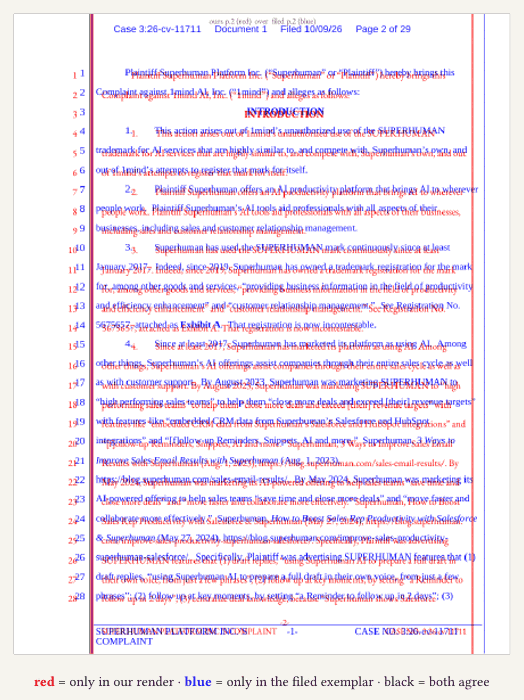

# Showcase

Every image here is generated from files committed in this repo. One script regenerates all of them (needs `pdftoppm`, `magick` and `typst` on your PATH):

```sh
just showcase
```

Labels and layout are typeset by typst with its bundled fonts, so the output does not depend on your installed fonts. The source documents are the sample folders named in each caption.

## hero.png


The target is the filed brief: the court's cover is what formbook is built to reproduce. Left, the first lines of the YAML header of `courts/dc-circuit/court-of-appeals/opening-brief/usage/INPUT-opening-brief.md` (your markdown); middle, formbook's rendered cover page from that file (`usage/OUTPUT-opening-brief.typst.pdf`, page 1); right, the cover page of the brief actually filed (`usage/FILED-EXAMPLE-opening-brief.pdf`, page 1, with the court's electronic-filing stamp). The two covers share their layout: centered oral-argument line, bold case number, short rules between blocks, caption with the designations set to the right, two-column counsel block, date at the margin. They differ in type (small caps on the court name, upper-case party names) and in how the third counsel group flows.

Regenerate all images, including this one: `just showcase`

## overlay.png



One page of the red/blue overlay for the N.D. Cal. complaint (`.overlay/courts/ninth-circuit/california/federal/northern-district/complaint/OVERLAY-complaint.pdf`, page 2, generated by `just overlay` and not committed): red is text only in our render, blue is text only in the filed exemplar, black is where both agree. The overlay PDFs are produced on demand by `tools/overlay.sh` (`just overlay <dir>`) into the gitignored `.overlay/`.

Regenerate: `just showcase`

## pages.png


Eight pages of one rendered brief (`courts/dc-circuit/court-of-appeals/opening-brief/usage/OUTPUT-opening-brief.typst.pdf`, pages 1, 2, 4, 5, 7, 11, 14 and 15): cover, certificate as to parties, table of contents, table of authorities, introduction, summary of argument, certificate of compliance, certificate of service. All generated from the markdown.

Regenerate: `just showcase`

## courts.png


Page 1 of the rendered sample from eight different courts and document types: U.S. Supreme Court merits brief, 1st and 3rd Circuit opening briefs, N.D. Cal. complaint, D. Md. bankruptcy adversary complaint, California Superior Court complaint, New York Supreme Court motion brief, Texas Supreme Court brief on the merits. The list is in `docs/showcase/make-screenshots.sh`.

Regenerate: `just showcase`

## folder.png


The layout of one doc-type folder (`courts/third-circuit/court-of-appeals/opening-brief/`): `README.md`, the filed exemplar and its `SOURCE.md`, the markdown input with our output and overlay, and the Typst template. Listing generated with `find`.

Regenerate: `just showcase`
