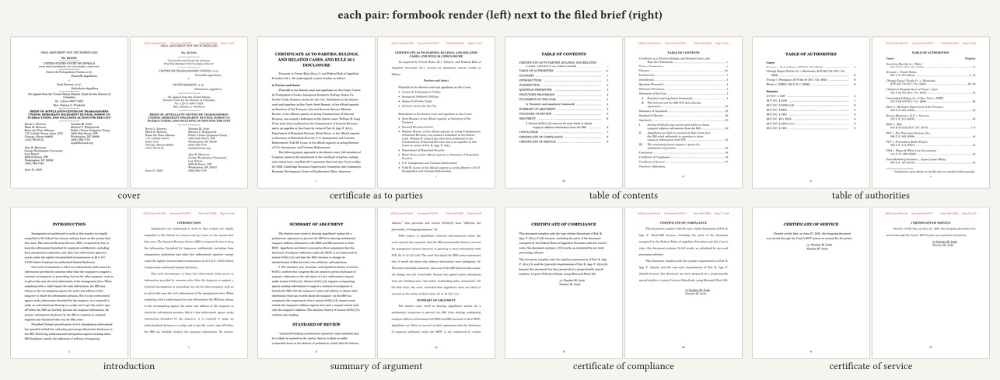
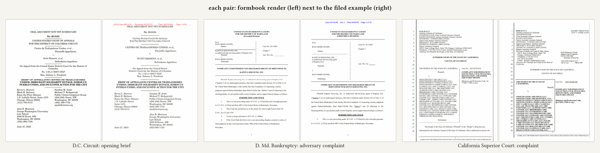
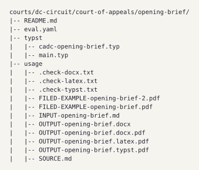

# Showcase

Every image here is generated from files committed in this repo. One script regenerates all of them (needs `pdftoppm`, `magick` and `typst` on your PATH):

```sh
just showcase
```

Labels and layout are typeset by typst with its bundled fonts, so the output does not depend on your installed fonts. The source documents are the sample folders named in each caption. Every image compares formbook's output with the filed example it is modelled on. For a text-level diff of your own render against its exemplar, `just overlay <dir>` writes a red/blue overlay PDF into the gitignored `.overlay/`.

## hero.png


The target is the filed brief: the court's cover is what formbook is built to reproduce. Left, the first lines of the YAML header of `courts/dc-circuit/court-of-appeals/opening-brief/usage/INPUT-opening-brief.md` (your markdown); middle, formbook's rendered cover page from that file (`usage/OUTPUT-opening-brief.typst.pdf`, page 1); right, the cover page of the brief actually filed (`usage/FILED-EXAMPLE-opening-brief.pdf`, page 1, with the court's electronic-filing stamp). The two covers share their layout: centered oral-argument line, bold case number, short rules between blocks, caption with the designations set to the right, two-column counsel block, date at the margin. They differ in type (small caps on the court name, upper-case party names) and in how the third counsel group flows.

Regenerate all images, including this one: `just showcase`

## pages.png



Eight pairs from the D.C. Circuit brief: formbook's render (`courts/dc-circuit/court-of-appeals/opening-brief/usage/OUTPUT-opening-brief.typst.pdf`, pages 1, 2, 4, 5, 7, 11, 14, 15) beside the page of the filed brief (`usage/FILED-EXAMPLE-opening-brief.pdf`, pages 1, 2, 5, 6, 16, 40, 71, 72) it corresponds to: cover, certificate as to parties, table of contents, table of authorities, introduction, summary of argument, certificate of compliance, certificate of service. The render is a portion of the brief, so body pages fall differently.

Regenerate: `just showcase`

## courts.png



Page 1 of the render beside page 1 of the filed example for three courts whose render matches closely: D.C. Circuit opening brief, D. Md. bankruptcy adversary complaint, California Superior Court complaint. Other folders are not shown because their covers do not match their exemplars yet (the per-court status is in the index of the top-level README). The list is in `tools/fb/src/showcase.rs`.

Regenerate: `just showcase`

## folder.png



The layout of one doc-type folder (`courts/dc-circuit/court-of-appeals/opening-brief/`): `README.md`, the filed exemplar and its `SOURCE.md`, the markdown input with our output and overlay, and the Typst template. Listing generated with `find`.

Regenerate: `just showcase`
